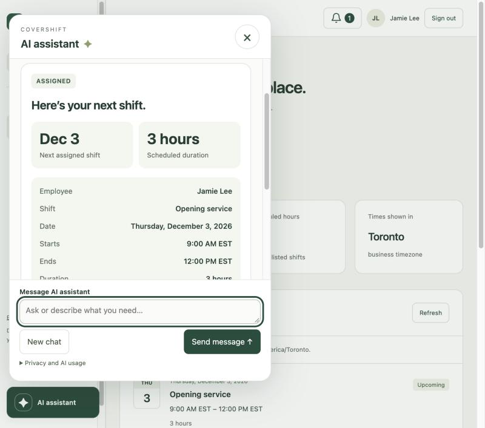

# CS-053 AI intent fallback, usage counting and request code

Issue [#127](https://github.com/EldarSadeghi/soen287-covershift/issues/127). Follow-up to #125 / PR #126. No new product features.

## What changed

- **One message, one allowance use.** When the local rules cannot route a message, `/api/ai-intent` classifies it and reserves one daily allowance use. For paid intents (`draft`, `search`, `availability`, `questions`) the response includes a single-use `pass`. The browser sends it back as `intentPass` with the follow-up request, and the server then skips a second reservation.
- **Pass rules** (`src/ai/intent-pass.js`): server memory only, 60-second lifetime, one outstanding pass per user, at most 1,000 passes. A pass is bound to the user, the classified intent and a SHA-256 of the exact trimmed message. It is removed on first use even when it does not match. An invalid, expired, replayed or mismatched pass is ignored and the request is charged normally. It is never rejected, so the chat keeps working.
- **Shared request builder.** `responsesBody()` in `src/ai/structured-response.js` builds every Responses API body: `store: false`, the reasoning setting only for `gpt-6-luna`, the output-token limit and a strict JSON schema. `aiConfigured()` replaces four copies of the configuration check.
- **Readability.** The AI routes in `src/app.js` (intent, schedule questions, availability draft, search, draft) and the request builders in the four AI modules are split into named, one-statement lines. The browser's classifier call moved into a named `classifyUnmatched()` helper.

## Acceptance results

| Check | Result |
| --- | --- |
| `npm run check` | Passed |
| `npm test` | 411 / 411 passed (8 new: 6 route and pass tests in `tests/ai-intent-route.test.js`, plus the 2 new scenarios that the suite also runs) |
| `npm run ai:acceptance` | 22 / 22 scenarios, 179 checks (new CS053-C01, CS053-C02) |
| Live paid provider calls | None |

### Route tests (`tests/ai-intent-route.test.js`)

- No session 401, wrong CSRF token 403, foreign origin 403, wrong content type 415, query string 400, GET 405.
- AI not configured 503. A provider failure returns 503 without provider text or the key.
- A manager never receives an employee-only intent or a pass.
- 20 requests per 2 minutes per user, then 429. Another user keeps their own budget.
- Classify, then answer = 1 reservation. A replayed pass, a different message, another user's pass, a pass used on another feature and a malformed pass are each charged normally.
- Pass store unit test: single use, expiry, replacement, bounded size, non-paid intents.

### Offline scenarios

- **CS053-C01**: "anything going for me on thursday afternoon" is unmatched locally, is classified as `search` and answered with matches. The allowance count stays at 1. Replaying the pass is charged (count 2). No business data is written.
- **CS053-C02**: a classifier HTTP failure returns a safe 503 without a pass. The chat's normal local clarification remains, and no further AI call is made (1 attempted reservation, 1 provider call).

### Browser check

Local preview on `127.0.0.1:3071` with fictional demo data and scripted provider replies, signed in as Jamie Lee. "Could you pull up when I punch in?" called `POST /api/ai-intent` (200), then `POST /api/ai-schedule-question` (200). The server logged exactly one allowance reservation, and the chat showed the next assigned shift card.

## Limitations

The scripted replies test workflow handling, not real-model language understanding. Measuring real classification accuracy is stage 2 (labelled evaluation set). Passes live in server memory: a restart between classification and answer simply charges the answer normally.
