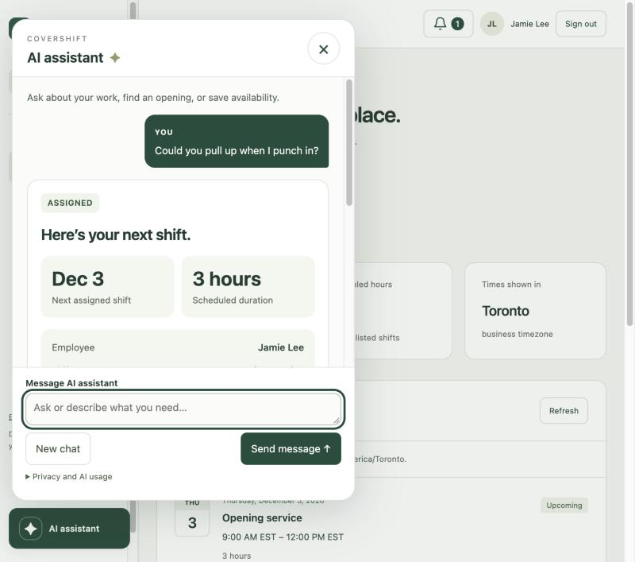

# CS-053 AI intent fallback, usage counting and request code

Issue [#127](https://github.com/EldarSadeghi/soen287-covershift/issues/127), PR [#128](https://github.com/EldarSadeghi/soen287-covershift/pull/128). Follow-up to #125 / PR #126. No new product features.

## What changed

- **Two separate counts.** Every provider call is reserved before it is made and counts toward the **lifetime cap** (500 calls per data directory), including failed and timed-out calls. The **per-user daily limit** (20) and the **short-term chat limit** (20 per 2 minutes) count **user turns**, not provider calls.
- **One message, one turn.** When the local rules cannot route a message, `/api/ai-intent` classifies it. That uses one short-term slot, one daily turn and one provider call. For paid intents (`draft`, `search`, `availability`, `questions`) the response includes a single-use `pass`. The browser sends it back as `intentPass` with the follow-up request. The server redeems the pass **before** applying the short-term limit and skips that limit. The handler still reserves its provider call against the lifetime cap, marked `turn: false` so the daily limit does not count it again.
- **Pass rules** (`src/ai/intent-pass.js`): server memory only, 60-second lifetime, one outstanding pass per user, at most 1,000 passes. A pass is bound to the user, the classified intent and a SHA-256 of the exact trimmed message. It is removed on first use even when it does not match. An invalid, expired, replayed or mismatched pass is ignored, and the request counts as a normal new turn. It is never rejected, so the chat keeps working.
- **Allowance records** (`src/ai/allowance.js`): `reserve(userId, now, timezone, { newTurn })`. A follow-up call writes `"turn": false`. Older records without the field still count as turns. The lifetime cap is checked for every call; the daily limit is checked only for new turns.
- **Shared request builder.** `responsesBody()` in `src/ai/structured-response.js` builds every Responses API body: `store: false`, the reasoning setting only for `gpt-6-luna`, the output-token limit and a strict JSON schema. `aiConfigured()` replaces four copies of the configuration check.
- **Readability.** The AI routes in `src/app.js` share one `readAiChat()` helper for pass redemption and the short-term limit. The request builders in the four AI modules are split into one-statement lines, and the browser's classifier call is a named `classifyUnmatched()` helper.

## Review fixes (Codex review of PR #128)

- **P1, lifetime cap:** the first version skipped the follow-up reservation, so a run of fallback turns could make up to twice the documented 500 provider calls. Fixed: every provider call is reserved, and only the daily turn count is shared.
- **P2, short-term limit:** the classifier and the answer each took a slot from the 20-per-2-minute limit, so a classification using the last slot left the answer with `429`. Fixed: a request with a valid pass skips the short-term limit, because its turn was already counted.

## Acceptance results

| Check | Result |
| --- | --- |
| `npm run check` | Passed |
| `npm test` | 415 / 415 passed |
| `npm run ai:acceptance` | 22 / 22 scenarios, 179 checks (CS053-C01, CS053-C02) |
| Live paid provider calls | None |

### Route tests (`tests/ai-intent-route.test.js`)

- No session 401, wrong CSRF token 403, foreign origin 403, wrong content type 415, query string 400, GET 405.
- AI not configured 503. A provider failure returns 503 without provider text or the key.
- A manager never receives an employee-only intent or a pass.
- The classifier is limited to 20 requests per 2 minutes per user, then 429. Another user keeps their own budget.
- Classify, then answer = 2 provider calls, 1 turn. A replayed pass, a different message, another user's pass, a pass used on another feature and a malformed pass each count as a new turn.
- With a lifetime cap of 1, the answer to a classified turn is refused (429) and no second provider call is made.
- With a daily limit of 1, the answer to the classified turn still runs; the next new turn is refused.
- When classification takes the 20th short-term slot, the answer still succeeds; a request without a pass is then limited.
- Allowance unit test: follow-up records count toward the lifetime cap but not the daily limit.
- Pass store unit test: single use, expiry, replacement, bounded size, non-paid intents.

### Offline scenarios

- **CS053-C01**: "anything going for me on thursday afternoon" is unmatched locally, is classified as `search` and answered with matches. Usage after classifying: 1 call, 1 turn. After answering: 2 calls, 1 turn. Replaying the pass: 3 calls, 2 turns. No business data is written.
- **CS053-C02**: a classifier HTTP failure returns a safe 503 without a pass. The chat's normal local clarification remains, and no further AI call is made (1 call, 1 turn, 1 provider request).

### Browser check

Local preview on `127.0.0.1:3071` with fictional demo data and scripted provider replies, signed in as Jamie Lee in a new chat. "Could you pull up when I punch in?" called `POST /api/ai-intent` (200), then `POST /api/ai-schedule-question` (200). The allowance directory then held two records: the classification (a new turn) and the answer (`"turn": false`). The chat showed the next assigned shift card.

## Limitations

The scripted replies test workflow handling, not real-model language understanding. Measuring real classification accuracy is stage 2 (labelled evaluation set). Passes live in server memory: a restart between classification and answer makes the answer count as a new turn.
