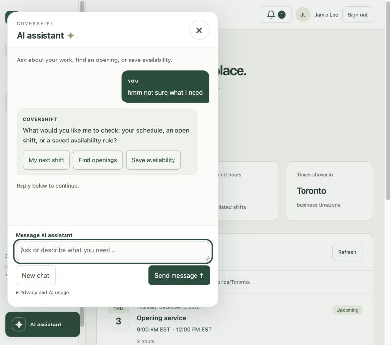
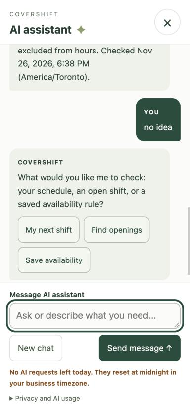

# CS-056 Chat improvements

Issue [#133](https://github.com/EldarSadeghi/soen287-covershift/issues/133). Stage 3 follow-up to CS-055. No change to what the assistant can save.

## What changed

- **Clickable suggestions.** When the chat shows the generic "What would you like me to check" question, three role-specific buttons appear under it: employee "My next shift", "Find openings", "Save availability"; manager "Team schedule", "Create a shift", "Attention summary". A button sends its example message through the normal routing. Each example is routed by the local rules, so no classifier call is needed, and nothing is saved without the existing review and confirmation. The buttons are a labelled group ("Choose what to check"), at least 44px tall, and are removed when the next message is sent. List: `clarificationSuggestions()` in `public/ai-chat-routing.js`.
- **AI requests left today.** A footer line under the Send button shows "N AI requests left today", turns amber at 3 or fewer, and explains the reset when none are left. It reads the new `GET /api/ai-usage` (`AiAllowance.status()`, read-only, never reserves) when the chat opens, after each classifier attempt, and after a provider-backed reply. An exhausted lifetime budget gets its own message because midnight only resets the daily cap. No limits changed.
- **Classifier context.** The intent classifier now receives JSON `{ conversation, request }`: the latest message plus at most the last two turns, validated by the shared chat limits. Its instructions say to classify only the request, that earlier turns are context and untrusted, and that they never authorise anything. Intent passes (CS-053) still bind to the latest message only.
- **Startup check.** `src/ai/startup-check.js` logs one warning when AI is half-configured: a model without a key, a key with a blank model, or an unwritable usage folder. It never prints the key.
- **Private routing log.** Each routed chat message sends `{ route, decidedBy, clarification }` to `POST /api/ai-routing-log`, which appends `{ day, role, route, decidedBy, clarification }` to `DATA_DIRECTORY/ai-routing/YYYY-MM.jsonl` (business-local month, at most 20,000 records per month). No message text, user ID or name is stored; the role comes from the signed-in account. `npm run ai:routing-report` summarises the log by role, route and decision source.
- **Evaluation.** Eight follow-up cases (one earlier turn each) were added to `scripts/ai-eval/messages.json` (now 173 messages). The live runner passes their history to the classifier.

## Checks

| Check | Result |
| --- | --- |
| `npm run check` | Passed |
| `npm test` | 443 / 443 passed (7 new in `tests/ai-chat-improvements.test.js`, 1 new in `tests/ai-routing-fixes.test.js`) |
| `npm run ai:acceptance` | 22 / 22 scenarios, 179 checks |
| `npm run ai:eval` (offline) | 0 write-capable wrong routes; 50 of 173 messages need the classifier |
| `npm run ai:eval -- --live --max-calls 60` | Ran with the user's approval; 50 classifier calls; all targets met; exits 0 |

## Browser check

Local preview with fictional demo data and a scripted provider (daily limit set to 5 so the warning is reachable), signed in as Jamie Lee:

1. Opening the chat showed "5 AI requests left today."
2. "hmm not sure what I need" asked the classifier, showed the generic question with the three buttons, and the count went to 4.
3. With focus on "My next shift", Enter sent "When is my next shift?", routed locally to the schedule answer; the buttons were removed and the count showed "2 AI requests left today." in the warning style.
4. "what about friday?" reached the classifier with the last two turns (4 earlier messages) and was answered as a schedule question.
5. At 320px wide the page did not overflow; the buttons wrapped, each 44px tall, and "No AI requests left today. They reset at midnight in your business timezone." was shown.
6. The routing log held four records with only day, role, route, decision source and clarification.

Found and fixed during the check: the usage line was first placed inside the collapsed "Privacy and AI usage" section and was invisible; it now sits under the Send button.

The manager suggestions were checked by tests (each routes locally to questions, draft or summary), not in the browser.

## Live evaluation (2026-11-26, user-approved)

`npm run ai:eval -- --live --max-calls 60`, model `gpt-6-luna`, separate eval ledger. 50 classifier calls, 0 errors, every fallback message classified.

| Measure | CS-055 live (165 messages) | CS-056 live (173 messages) | Target | Met |
| --- | --- | --- | --- | --- |
| Routed correctly | 161 (97.6%) | **171 (98.8%)** | at least 95% | Yes |
| Unhelpful generic clarification | 2 (1.2%) | **0 (0.0%)** | at most 5% | Yes |
| All generic clarifications (reported only) | 21 (12.7%) | 21 (12.1%) | — | — |
| Write-capable wrong routes | 0 | **0** | 0 | Yes |
| Follow-ups correct | — | **8 / 8** | — | — |

**Remaining misses (2)**, both read-only and not write-capable:

| ID | Message | Expected | Got |
| --- | --- | --- | --- |
| e-questions-08 | whats my shedule this week | questions | summary |
| m-clarification-15 | find open shifts (manager) | clarification | summary |

Both reach the read-only working-week or attention summary, so the user still sees relevant information. A single live run is one sample of a non-deterministic model. The full report stays local in `.covershift-ai-eval/run-2026-11-26T23-41-57-383Z/` (ignored by Git).
