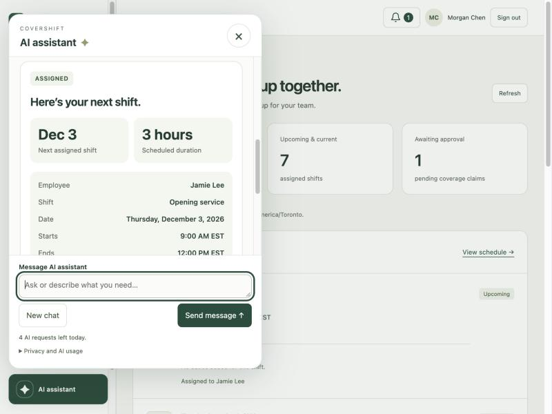

# CS-063 Routing cleanup and remaining routing fixes

Issue [#147](https://github.com/EldarSadeghi/soen287-covershift/issues/147). Follow-up to the CS-057–062 review (rated 9/10). Layout and rules: [docs/ai-chat-routing.md](../../ai-chat-routing.md).

## Baseline (main at `27b873a`, after `npm ci`)

`npm run check` passed (syntax and format), 487 tests, 25 offline scenarios with 217 checks, offline evaluation 205 / 247 with 61 classifier candidates and 0 write-capable wrong routes.

## What changed

- **Routing snapshot.** `tests/routing-snapshot.test.js` and `scripts/routing-snapshot.mjs` record what every routing function returns for 279 phrases (the 247 evaluation messages plus edge cases), for both roles, and 144 multi-turn follow-ups.
- **Split.** `public/ai-chat-routing.js` went from 847 to 392 lines and is now the coordinator. Patterns moved to seven modules in `public/routing/`. The longest routing line went from 351 to 198 characters: long patterns are built from named, commented parts with `anyOf`. **The snapshot was identical after the split** (279 phrases, 144 follow-ups).
- **Served modules.** The seven modules were added to the server's file list, and `tests/served-modules.test.js` follows every import from each page's entry script. Removing one entry made it fail ("/routing/dates.js is imported but not served"), so it catches this mistake.
- **Group tests.** `tests/routing-groups.test.js` has must-match and must-not-match examples for each module.
- **Fixes** (snapshot changed only for these):
  - "whats my shedule this week" and other common misspellings of "schedule" route to schedule questions for both roles.
  - A manager's "find open shifts" (and "show open shifts", "any openings…") gets a specific answer, "Open-shift search is for employees…", with no classifier call. Employees' routes for the same messages are unchanged.
  - "cancel … shift" is blocked for both roles ("cancel Jamie's Friday shift"), without catching "cancel my availability rule", a claim or a cover request.
- **Formatting.** The format check now covers `src/app.js`, the routing modules and the new tests. `src/app.js` was reformatted with Prettier (614 dense lines to 1,813 readable lines, none over 200 characters).

## Checks

| Check | Result |
| --- | --- |
| `npm run check` | Passed (syntax and format) |
| `npm test` | 498 / 498 passed (11 new) |
| `npm run ai:acceptance` | 25 / 25 scenarios, 217 checks |
| `npm run ai:eval` (offline) | 206 / 247 local, 59 classifier candidates (was 61), 0 write-capable wrong routes, exit 0 |
| Live evaluation (2 runs, user-approved) | Run 1: 246 / 247; run 2: 247 / 247; all targets met in both, exit 0 |

## Browser check

Isolated preview with fictional demo data and scripted provider replies, signed in as Morgan Chen. The chat loaded with no console errors, and all seven `/routing/*.js` modules returned 200. "find open shifts" gave the manager answer, "cancel Jamie's Friday shift" gave the unsupported-command reply, and "whats my shedule this week" was answered as a schedule question. None of the three called the intent classifier.

## Live evaluation (2026-11-27, two runs, user-approved)

`npm run ai:eval -- --live --max-calls 70`, run twice, model `gpt-6-luna`, separate eval ledger. Each run made 59 classifier calls with 0 errors, and every fallback message was classified.

| Measure | CS-062 (before) | CS-063 run 1 | CS-063 run 2 | Target |
| --- | --- | --- | --- | --- |
| Routed correctly | 245 / 247 (99.2%) | **246 / 247 (99.6%)** | **247 / 247 (100%)** | at least 95% |
| Unhelpful generic clarification | 0 | **0** | **0** | at most 5% |
| Write-capable wrong routes | 0 | **0** | **0** | 0 |
| Classifier calls | 61 | 59 | 59 | — |

**Both earlier misses are fixed in both runs, and are now decided locally:** "whats my shedule this week" routes to schedule questions, and a manager's "find open shifts" gets the local explanation. Neither depends on the model any more.

**The one difference between runs:** in run 1 the classifier sent "my coverage decisions this week" to coverage history instead of the working-week summary. In run 2 it was correct. This is ordinary model variation on a classifier-routed message. It is read-only and not write-capable.

The full reports stay local in `.covershift-ai-eval/run-2026-11-27T04-27-42-219Z/` and `run-2026-11-27T04-28-46-337Z/` (ignored by Git).
